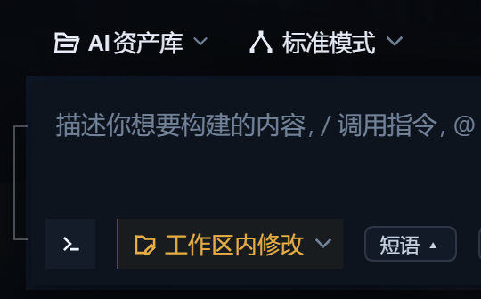

# dsh-composer-phrases



A client-side plugin for [DeepSeek Harness](https://github.com/deepseek-ai/deepseek-harness) (`dsh`).
It adds one small capsule to the composer tool row. Clicking a phrase **inserts it at the caret**;
it never sends.

That difference is the whole point. Most phrase plugins send a stored line for you. This one writes
into the draft you are already editing, so you can drop in a half-sentence, keep typing, and send
when it is actually ready.

## What it does

- A light `短语 ▴` capsule sits in the composer tool row, right of the permission and plan controls.
- Click it and a narrow vertical panel opens upward.
- Click a phrase: it is written at the caret. Text already in the draft stays where it was.
- The panel has an input at the bottom: type a line, press Enter or click `添加` to save it.
- Every row has `×` to delete. Delete them all and the panel stays empty — the seed list is never
  silently restored.
- Click outside, or click the capsule again, to close. The caret flips to `▾` while open.
- While the composer is busy (`submitting` / `adjudicating`), phrase rows are disabled.
- If the caret insert cannot be done (both attempts go stale), the phrase is appended at the end of
  the draft behind a space, and the capsule **replaces its own label** with `已追加到末尾` for a few
  seconds. It never appends silently. Because the notice is the button's text, it cannot be clipped
  by the card and it overlays nothing to its right. The wording stays short so the pill widens by only
  a few pixels while the notice is up.
- The pill stays 20px tall so the tool row keeps its density, but its hit area is padded out to about
  36px, and on touch devices it grows to 28px tall and 44px wide.
- Phrases live in this browser's `localStorage` only.

## Insert, not send

| | quick-reply style | this plugin |
|---|---|---|
| click a phrase | sends the message | writes it at the caret |
| existing draft | replaced or conflicted | preserved, still editable |
| best for | canned one-line answers | prompts you keep reusing, or a prefix you finish by hand |

## Install

```sh
dsh plugin --profile <profile> add "<absolute-path>.tgz"
```

**Desktop profile exception.** The CLI refuses it:
`error: profile "desktop" is managed exclusively by the Electron application`.
Install through the app's own plugin manager (local package / directory), or the plugin management
tool (`plugin_manager` / `install_bundle`).

### If the Release download is blocked

On some networks `release-assets.githubusercontent.com` is unreachable, so the Release asset
cannot be downloaded even though the page loads. The same tarball is committed in
[`dist/`](dist/) of this repository for that case:

```sh
# clone or fetch the repo, then install the committed tarball
dsh plugin --profile <profile> add "<repo>/dist/dsh-composer-phrases-<version>.tgz"
```

### Check the archive before installing

```sh
tar -tzf <package>.tgz     # 9 entries = the 7 entries in package.json "files", plus
                           # package.json and LICENSE (npm adds LICENSE automatically)
tar -xzf <package>.tgz -C <temp-dir>
node <temp-dir>/package/test/harness.mjs   # ALL GREEN: 80/80 checks passed
```

All behavior lives in `lib/client.js` and can be read line by line. `lib/index.js` is the host half
and deliberately does nothing.

## Verify

New installs usually need one restart of `dsh`. A `link:` install hot-reloads instead.
Then look at the composer tool row: the capsule appears to the right of the permission chip.
If your build can inspect slots, the stronger check is that `conversation.input.left` lists an
occupant with `id: composer-phrases` and `active: true`.

### Manual end-to-end check

The harness is logic-level (a React stand-in and a fake DOM). Three things still need a human click,
and this is the list to walk through after installing:

1. The capsule appears to the **right of the permission chip** in the composer tool row.
2. Clicking a phrase writes it **at the caret**, and text already in the draft stays unchanged.
3. While the composer is sending, the phrase rows are **disabled**.

If any of these fails, the plugin either did not take the seat or this build uses a different slot
name. Check whether `conversation.input.left` exists, and if it does not, change the `SLOT` constant
at the top of `lib/client.js`.

## Uninstall

```sh
dsh plugin --profile <profile> remove dsh-composer-phrases
```

## Seat and implementation

| | |
|---|---|
| Seat | `conversation.input.left` (composer tool row) |
| Registrant id / order | `composer-phrases` / `0` |
| Insert path | `inputActions.captureInsertion()` → `inputActions.insertText(text, span)` (one retry) → `inputActions.setDraft(draft + text)` as the last resort |
| Draft read | the seat's standard `useInput` hook |
| Storage key | `dsh-composer-phrases/phrases/v1` |
| Dependencies | only the host-provided `react`; no build step |

The two halves:

- `lib/index.js` — host half; `apply()` is empty because all behavior is in the browser.
- `lib/client.js` — browser half; injects the stylesheet, takes the seat, renders the capsule and panel.

The registration declares no `inject` face, only `{ name, id, order }`. Standard seat props
(`inputActions`, `useInput`) are handed down by the shell, exactly as they are for the shipped todo
dock, which also registers without an inject face.

## Offline self-test

```sh
node test/harness.mjs      # 80 checks
```

Covers the bundle handoff, host-only `react`, style-tag injection and cleanup, seat and order,
closed-by-default, open/caret flip, insert-and-close, caret insert that leaves the draft intact,
stale-revision retry and fallback, inert without the API, disabled while busy, add (trim/dedupe/Enter),
delete, empty stays empty, outside-click close, no leaked listener, corrupt-storage fallback, and no
network access.

The page receives React from the host, so the harness ships a minimal React stand-in (state, effects
with cleanup, refs) plus a fake DOM. It is a logic-level check; the manual list above is the
end-to-end half.

## Compatibility

Click-tested end-to-end on **DSH 0.2.0-rc.2 (cordis 4.0.4)**: the capsule appears, the caret insert
works, and the busy state disables the rows.

The host slot `conversation.input.left` is also present in **DSH 0.2.1 (cordis 4.0.5)**, so the 0.2.x
line is expected to work — but this exact tarball has not been click-tested there. Anything newer is
untested. On a very different version the slot may not be rendered; the failure mode is
"installs but never appears", not a crash. Check whether `conversation.input.left` exists, and if it
does not, change the `SLOT` constant at the top of `lib/client.js` to `conversation.input.right` or
`conversation.composer.dock`.

## Privacy

Local-only. No service injection, no Cordis events, no model requests, no network, no filesystem
access. The phrase list lives in `localStorage` and nowhere else.

## License

MIT
