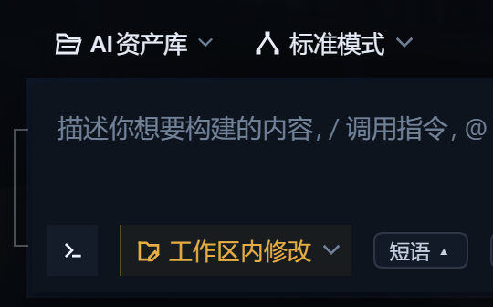

# dsh-composer-phrases



[DeepSeek Harness](https://github.com/deepseek-ai/deepseek-harness)（`dsh`）的客户端插件。
在输入卡片底部的工具行加一个小胶囊，点开是一条条短语；**点短语是把它按光标插进输入框，不是发送。**

这个区别就是它的全部意义：多数短语插件替你「发出去」，这个只是替你「写进去」，你已经打的字还在，
可以接着改，想好了再发。

## 它做什么

- 工具行里有一颗浅色胶囊 `短语 ▴`，就在权限选择与计划控件右边。
- 点一下，向上展开一个窄的竖排面板。
- 点某条短语：按光标位置写进输入框，已有的草稿一个字不动。
- 面板底部可以添加：输入内容，回车或点 `添加`。
- 每条右侧 `×` 删除；**删光就保持空**，不会偷偷把默认短语塞回来。
- 点面板外面、或再点胶囊收起；展开时箭头是 `▾`。
- 输入框正在发送（`submitting` / `adjudicating`）时，短语行变灰不可点。
- 短语只存在这台机器的浏览器 `localStorage` 里。

## 插入，不是发送

| | 快捷回复类插件 | 本插件 |
|---|---|---|
| 点一条短语 | 直接把消息发出去 | 按光标写进输入框 |
| 已有草稿 | 被替换或冲突 | 原样保留，还能接着改 |
| 适合 | 固定的一句话回复 | 反复复用的长提示词，或自己补完的开头 |

## 安装

```sh
dsh plugin --profile <profile名> add "<包文件绝对路径>.tgz"
```

**桌面版 profile 例外**：命令行会拒绝，报
`error: profile "desktop" is managed exclusively by the Electron application`。
这种 profile 要在 App 自带的插件管理器里装（选本地包/目录），或用插件管理工具
（`plugin_manager` / `install_bundle`）。

### Release 下载不了时

部分网络下 `release-assets.githubusercontent.com` 不可达，Release 页面能打开、附件却下不下来。
同样的包已提交在仓库的 [`dist/`](dist/) 里，直接取那个文件安装即可：

```sh
# 先把仓库拉下来，再装仓库里那份 tgz
dsh plugin --profile <profile名> add "<仓库>/dist/dsh-composer-phrases-<版本>.tgz"
```

### 装之前核一遍包

```sh
tar -tzf <包文件>.tgz     # 9 项 = package.json "files" 里的 7 项 + package.json + LICENSE
                          # （LICENSE 是 npm 自动附带的，手工按 files 打包只有 8 项）
tar -xzf <包文件>.tgz -C <临时目录>
node <临时目录>/package/test/harness.mjs     # ALL GREEN: 75/75 checks passed
```

全部行为都在 `lib/client.js` 里，可以逐行核对；`lib/index.js` 是宿主半边，故意什么都不做。

## 验证

新装通常要重启一次 `dsh`；以 `link:` 接入的会热重载。然后看输入卡片工具行：权限选择右侧应出现
那颗胶囊。若你的 dsh 能查插槽，更硬的证据是 `conversation.input.left` 的占用者里有
`id: composer-phrases`、`active: true`。

### 端到端手动核对（装完请走一遍）

自测是逻辑级的（自带 React 替身与假 DOM），下面三条只有人能点出来：

1. 胶囊出现在工具行里、**权限选择控件的右侧**。
2. 点一条短语，文字**落在光标处**，输入框里原有的草稿不变。
3. 输入框正在发送时，短语行**变灰不可点**。

任何一条不对，说明插件没坐上位子，或这个版本用的是别的插槽名。先查
`conversation.input.left` 是否存在；不存在就改 `lib/client.js` 顶部的 `SLOT` 常量。

## 卸载

```sh
dsh plugin --profile <profile名> remove dsh-composer-phrases
```

## 座位与实现

| | |
|---|---|
| 座位 | `conversation.input.left`（输入卡片工具行） |
| 注册 id / order | `composer-phrases` / `0` |
| 插入路径 | `inputActions.captureInsertion()` → `inputActions.insertText(text, span)`（失败重试一次）→ 兜底 `inputActions.setDraft(draft + text)` |
| 草稿读取 | 座位提供的标准钩子 `useInput` |
| 存储键 | `dsh-composer-phrases/phrases/v1` |
| 依赖 | 只用宿主提供的 `react`，免编译 |

两个半边：

- `lib/index.js`：宿主半边，`apply()` 空实现，因为行为全在浏览器端。
- `lib/client.js`：浏览器半边，注入样式、占座、渲染胶囊与面板。

注册时不声明 `inject`，只写 `{ name, id, order }`。座位标准属性（`inputActions`、`useInput`）
由宿主下发，官方自带的 todo dock 同样不声明注入也能拿到。

## 离线自测

```sh
node test/harness.mjs      # 75 项
```

覆盖：bundle 交接、只依赖宿主 react、样式注入与卸载清理、座位与 order、默认收起、开面板与箭头翻转、
点选插入并收起、按光标插入不改动已有草稿、版本过期重试与兜底、无接口时不炸、忙时禁用、
添加（去空格/去重/回车）、删除、删空保持空、点外面关闭、监听器不残留、存储损坏降级、全程零联网。

页面里的 React 由宿主注入，所以测试台自带一个极小的 React 替身（状态、带清理的副作用、ref）
和假 DOM。这是**逻辑级**验证；端到端那半在上面那份手动清单里。

## 版本前提

在 **DSH 0.2.0-rc.2（cordis 4.0.4）** 上做过端到端点击验证：胶囊出现、按光标插入生效、忙时禁用。

宿主插槽 `conversation.input.left` 在 **DSH 0.2.1（cordis 4.0.5）** 上同样存在，因此 0.2.x 系列
**预期可用**——但这一版 tgz 没有在 0.2.1 上实际点击验证过。更高版本未验证。

版本差得远时座位可能不渲染，表现为「装上了但不出现」，不会崩。先查
`conversation.input.left` 是否存在；不存在就改 `lib/client.js` 顶部的 `SLOT` 常量，
换成 `conversation.input.right` 或 `conversation.composer.dock`。

## 隐私

纯本地：不注入服务、不发 Cordis 事件、不触达模型请求、不联网、不读写文件系统。
短语只存在 `localStorage`。

## 许可

MIT
